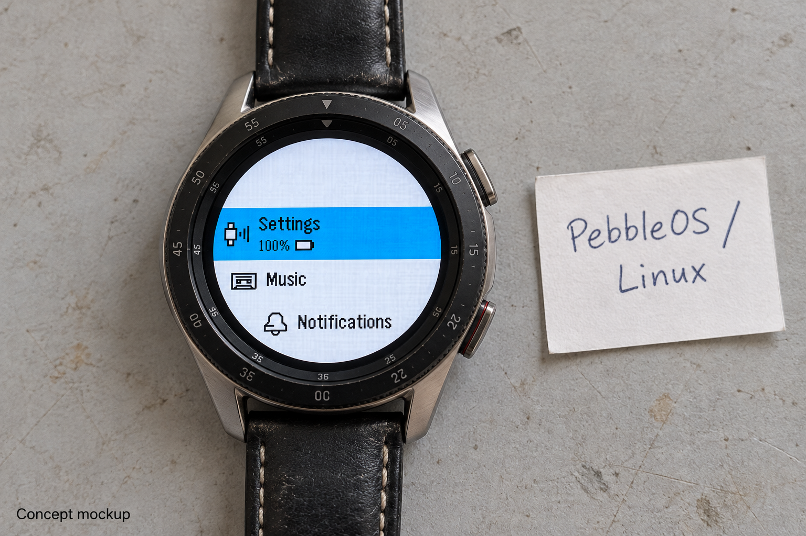
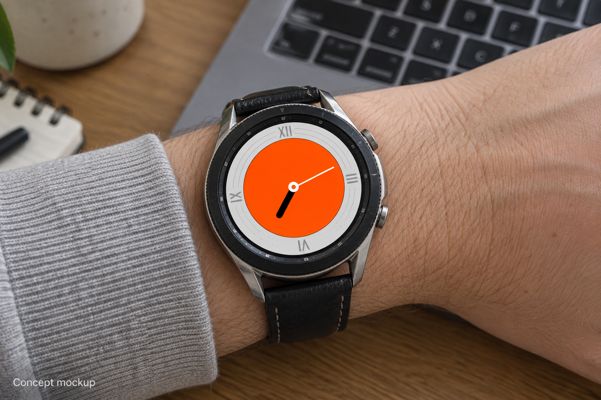

# PebbleOS on Linux

This fork runs [PebbleOS](https://github.com/coredevices/PebbleOS) as a Linux process. It keeps
the PebbleOS scheduler, services, apps and UI, and adds Linux display, input, battery and device
adapter drivers. The Samsung Galaxy Watch3 SM-R850 is the reference hardware.



*AI-generated concept mockup using a captured PebbleOS screen.*

<details>
<summary>Clock view</summary>



</details>

On the Galaxy Watch3, the port runs alongside Samsung's Linux kernel and Tizen userspace. It
renders a 260 × 260 round UI on the 360 × 360 display through Wayland or the framebuffer and
reads buttons, bezel and touch through evdev. A separate Galaxy Watch3 connector handles Tizen
sensor, haptic and display-power APIs over Unix datagram sockets.

## Status and compatibility

This is an experimental source candidate for developers. Earlier builds reached the launcher
and handled controls and phone notifications on a physical watch. The current **protocol-v2 OS
and connector have not yet been tested together on hardware**. Host tests and AArch64/ARM32
cross-builds pass; battery endurance, sensor accuracy, suspend and display timing still need
on-watch validation. The Linux OS/mock boot CI job is configured but has not run for this candidate.

| Target | Output |
| --- | --- |
| `native_gabbro/galaxy_watch3` | Static AArch64 Linux executable |
| `native_gabbro/galaxy_watch3_arm32` | ARM32 Linux executable using the device's glibc loader |

The connector is ARM32 to match Tizen's libraries and can communicate with either OS build.
Use matching protocol-v2 sources; the v1 connector is incompatible. Other watch models and
existing Pebble applications need separate compatibility testing.

## Build the Linux port

Use this checkout for the steps below. Install the host packages and PebbleOS SDK described in
the [getting-started guide](docs/getting_started/index.md), plus CMake, Ninja and Zig. Zig 0.17.0
was used for the candidate cross-builds. The native bootstrap fetches only the required
submodules and applies the included NimBLE patch.

```sh
sh tools/linux/bootstrap-native.sh
python3 -m venv .venv
. .venv/bin/activate
python -m pip install -r requirements.txt

cmake -S . -B build-galaxy -GNinja \
  -DBOARD=native_gabbro/galaxy_watch3 \
  -DPEBBLEOS_SDK_ROOT=/path/to/pebbleos-sdk
cmake --build build-galaxy --parallel 4
```

Replace `/path/to/pebbleos-sdk` with the installed SDK directory. Put Zig on `PATH`. The outputs
are `build-galaxy/pebbleos` and `build-galaxy/system_resources.pbpack`; use the ARM32 board name
and a separate build directory for the other architecture.

Follow the [Linux port guide](docs/development/emulation/linux_port.md) for runtime directories,
device profiles, display selection and Left Hand Mode. Starting on a watch also requires the
matching connector and permission to use the device interfaces. This source candidate does
not install a boot service or provide a flashable Galaxy Watch3 firmware image.

## Test without a watch

```sh
sh tests/linux_adapter/run.sh
sh tests/linux_adapter/run_display_regressions.sh
```

The first command needs a C11 compiler and pthreads. It tests the protocol client with a mock
adapter. The display tests need a C23 compiler and Linux framebuffer headers; on macOS, set
`LINUX_HEADERS` to Zig's `lib/libc/include/any-linux-any` directory. Neither command needs the
watch or the PebbleOS SDK.

The [Linux port guide](docs/development/emulation/linux_port.md#tests) covers firmware unit tests
and the OS/mock boot workflow. The [protocol specification](docs/drivers/linux_adapter_protocol.md#before-release)
lists the hardware checks required before a device release.

## Work on the port

| Area | Source |
| --- | --- |
| Adapter client and protocol header | `drivers/linux_adapter/`, `include/pbl/drivers/linux_adapter.h` |
| Linux display and controls | `drivers/display/linux/`, `drivers/button/linux/`, `drivers/touch/linux/` |
| Watch configurations | `boards/native_gabbro/` |
| Mock adapter and protocol tests | `tests/linux_adapter/` |
| Linux build bootstrap | `tools/linux/bootstrap-native.sh` |

Device-specific vendor APIs belong in a separate adapter. The OS owns UI and display policy
and remains interactive when no adapter is available. Read the
[adapter protocol](docs/drivers/linux_adapter_protocol.md) and
[device-profile format](docs/drivers/linux_device_profile.md) before adding another watch.

See [CONTRIBUTING.md](CONTRIBUTING.md) for contribution, sign-off and AI attribution rules.
General PebbleOS architecture and development documentation remains in [docs/](docs/index.md).

## Upstream and license

This work is based on [Core Devices' PebbleOS](https://github.com/coredevices/PebbleOS).
Packaged snapshots include `SOURCE_ORIGIN.json`, which records the workspace base commit and
dependency pins. PebbleOS retains [Apache-2.0](LICENSE); dependencies
retain their own licenses. Samsung's runtime libraries are supplied by the device and are not
included here.
