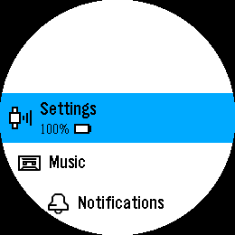
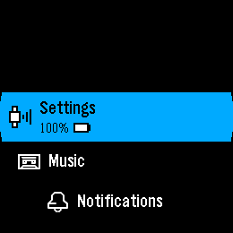
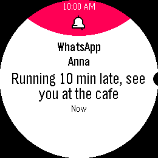
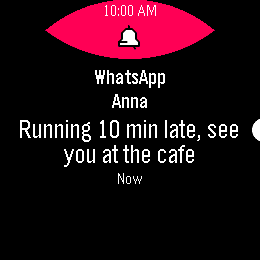
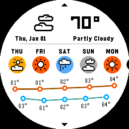
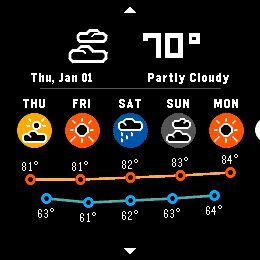
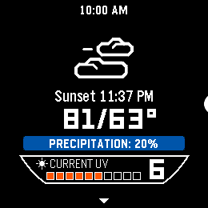
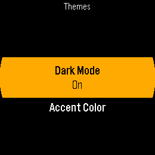
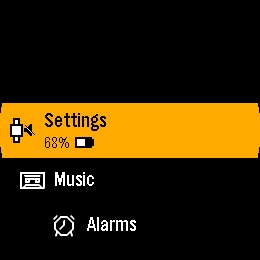
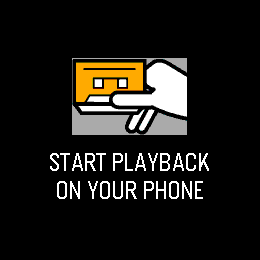

# Linux dark-mode verification

Dark mode is enabled through **Settings → Themes → Dark Mode** on Galaxy Watch3 builds.
The default remains Off. System backgrounds use pure black; accent colors, colored Timeline
cards, notification headers, album art and watchfaces retain their own appearance.

## Captured appearance

These are actual 260 × 260 native simulator frames, captured on 2026-10-30.

| Screen | Light | Dark |
| --- | --- | --- |
| Launcher |  |  |
| Notification |  |  |
| Weather |  |  |

Within the round panel, these samples have 72.4%, 82.3% and 83.2% pure-black pixels in dark mode,
compared with 3.7%, 5.4% and 6.3% in light mode. These are pixel counts, not battery measurements.

| Expanded weather | Globe intro | Revealed globe |
| --- | --- | --- |
|  |  |  |

## Checks

- The host unit suite passes all 414 CTest checks, including graphics image comparisons.
- New theme tests cover rectangular and circular buffers, all 256 pixel values, preserved alpha,
  clipping, neutral icons, toggling, monochrome displays, disabled theming and recovery firmware.
- UI tests check three light/dark round trips with pixel-identical restoration and persistence
  of both On and Off across process restarts.
- Both Linux watch targets build: static AArch64 and ARM32 with the device's glibc loader.
- The manual survey covers launcher rows, settings and nested pickers, notification lists and
  popups, alarms, music, watchfaces, Timeline, Health, Workout, calls and weather with injected
  forecast data. First-use and unavailable-data screens are included.
- The saved pre-change host binary (`46f133f`) and current light-mode build produce 76 matching
  capture names. 71 match exactly. The other five differ only within the animated sloth or
  weather cloud; the remaining pixels match.
- Transition captures sample frames 40 ms apart while opening and closing apps, entering
  Timeline, opening a pin, and entering and revealing the weather globe in both directions.
  The globe test rejects frames with more than 25% white pixels in dark mode, catching the
  white-space inversion seen in the original implementation.
  All 100 sampled forward/reverse reveal frames pass after the fix.

Some survey pages intentionally animate, so `wait_idle` times out and captures their current
frame. Review `_unstable.txt` with the screenshots. A successful capture run alone does not
establish that every screenshot depicts the intended screen. App pages are launched by UUID;
menu navigation uses a 350 ms gap to avoid dropping clicks during scrolling animations.

## Rendering cost

An isolated benchmark of the real color/filter sources, compiled with Apple Clang 21 at `-Os`
on an arm64 Mac, measured a median 0.035 ms per 260 × 260 rectangular filter pass over seven
trials of 2,000 calls. The maximum trial average was 0.042 ms. The light-mode early return was
below the useful resolution of this benchmark. This is a host microbenchmark, not an on-watch
frame-time measurement.

The filter uses a 64-byte lookup table and no per-frame allocation. It is opt-in for the custom
weather windows; the other themed screens draw their chosen colors directly. The globe reveal
themes its line art directly, preserving its black space background and original color pixels
throughout the transition. No periodic theme timer or display refresh is added.

The native port excludes the firmware's Cortex-M profiler. Physical watch frame timing, display
power and battery endurance remain unmeasured. The checks above found no host rendering
regression; they do not establish a hardware performance guarantee.

## Galaxy Watch3 verification

The ARM32 runtime from `17526f1` was installed on an SM-R850 running Tizen
`R850XXU1DWK2` on 2026-10-30. Its connector, system resources and boot ramdisk
were unchanged. Startup remains `samsung-debug`, with both autostart markers absent.
Only the running Pebble service was restarted; the watch was not rebooted.

These are captured driver frames from the watch, not optical photographs:

| Themes | Launcher | Music | Globe |
| --- | --- | --- | --- |
|  |  |  |  |

A controlled run verified all 40 alternating theme changes while the display was awake.
Each transition checked the displayed background pixel and captured the full frame.
Another run sent 4,000 scrolling inputs through four menus and opened weather/launcher
100 times with the display held awake. The runtime PID remained unchanged, the phone stayed
connected, and the scoped log contained no panic, assertion, app fault or full-queue report.
Resident memory changed from 28,264 to 28,396 KiB, with the same 28,564 KiB high-water mark
and 14 threads. This bounded sample does not establish long-term leak freedom.
Dark mode remained On after three service restarts; the phone reconnected and the system
resources remained valid. Quiet Time was restored to Manual Off, and the original Internal
watchface (install id 1) was retained.

On-device globe captures sampled 35 frames in each direction. The peak white-pixel fraction
within the round panel was 2.15% forward and 13.64% reverse, below the 25% flash threshold.
An isolated ARM32 benchmark of the real filter sources measured a median 0.817 ms per
260 × 260 rectangular pass over seven trials of 2,000 calls. CPU frequency varied during
the run. This measures filter cost, not complete frame time or battery consumption.

The full host CTest suite was rerun: 414/414 passed. The five theme-color configurations
also passed 100 consecutive repetitions each (500 checks). Linux adapter protocol, display,
connector, input and plugin compatibility checks passed. The protocol, display and connector
suites passed again with AddressSanitizer and UndefinedBehaviorSanitizer.
The native UI profile passed all 10 tests. Python tools, loghash and Pulse2 suites passed
330 tests plus 27 subtests. The older `pblconvert` suite cannot collect its four test modules:
it imports `cairosvg.surface.helpers`, an API absent from the available CairoSVG package.
Those conversion sources are unchanged by dark mode. Isolated on-watch scheduler probes
passed timeout/early-IRQ tick accounting, descriptor/thread wake and quit deadlines,
and cancellation/single-unlock checks. The older standalone tickless link helper needed
a test-only no-op `linux_adapter_idle` stub; adapter telemetry was tested separately.

The normal virtual-Bluetooth integration profile reported 97 passed, 2 failed, 10 skipped
and 1 unexpected pass. Its console-only connection cannot execute the screenshot/protocol
UI cases; those run separately with the native display connection. The two failures are
`voice/test_voice.py::test_rejected` (missing session-rejection log) and
`bluetooth/test_data_endpoints.py::test_data_logging` (heartbeat command timeout).
Both fail again individually and on a separately rebuilt pre-dark-mode `46f133f` revision.
Neither the voice/analytics sources nor these tests changed on this branch. These remain
known failures; the whole integration suite is not green. The unexpected pass is the
previously expected failure for deleting a notification while it is displayed.

Native Gabbro's missing normal UI reference images were captured from the saved `46f133f`
executable. Recovery uses a separate simulator build with Samsa disabled (recovery runs no
third-party apps) and a Clang exception for two existing pointer-to-enum warnings in MFG
screens. The full recovery profile finished with 51 passed, 1 failed and 4 skipped,
including the 12-minute connected-idle check. `prf/test_idle_shutdown.py::test_turns_off_when_idle`
timed out in `wait_for_log` after 720 seconds. The expected standby message is present in
`native.log` at the ten-minute boundary, but was not observed through the harness log stream.
This assertion remains failed; a native stdout message alone does not prove a physical power-off.
The four skips are battery emulation, firmware installation without a normal bundle, and two
screen-capture cases. Power-meter and physical-board checks require their corresponding lab.

The debug connection holds a wakelock, and stress captures deliberately keep the panel awake.
These checks do not measure wrist-raise reliability, power draw or unattended battery endurance.

## Reproduce

From the repository root, with the normal build dependencies on `PATH`:

```sh
cmake -S . -B build-dark -GNinja -DBOARD=native_gabbro -DCONFIG_THEMING=y
cmake --build build-dark --parallel 8
pbl test -j 8 --output-on-failure

ctest --test-dir build-test -R system_theme_color --repeat until-fail:100 --parallel 5

cd tests/integration
pytest --build-dir=../../build-dark --results-dir=/tmp/theme-tests \
  ui/test_dark_mode.py --dut-scope=function
DARK=1 SURVEY_OUT=/tmp/theme-captures pytest --build-dir=../../build-dark \
  --results-dir=/tmp/theme-survey ui/dark_mode_survey.py --dut-scope=function -n 4
```

For the complete host UI profile, run `pytest system ui notifications` with the same
native build. For the virtual-Bluetooth profile, configure a separate native build with
`-DCONFIG_BT_HCI_UART=y` and run the default integration collection with `-n 4` and
`--dut-scope=function`. Keep it separate from the display profile, since the connection
capabilities differ. The failures described above are expected to be reported, not suppressed.

`dark_mode_survey.py` is an explicit manual survey and is not collected by the default suite.
Use `DARK=0` and a separate output/results directory for light captures. Keep each concurrent
run's results directory separate. These reproduction commands run on the host; they do not
install or flash the physical watch.
